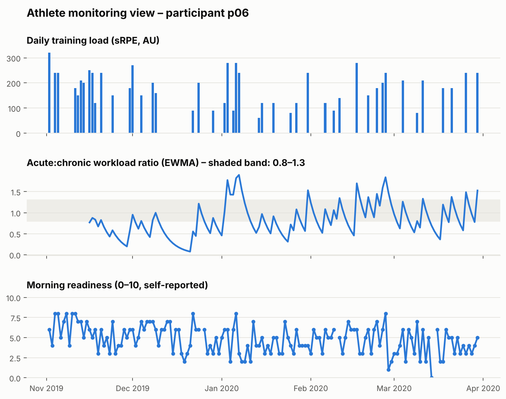
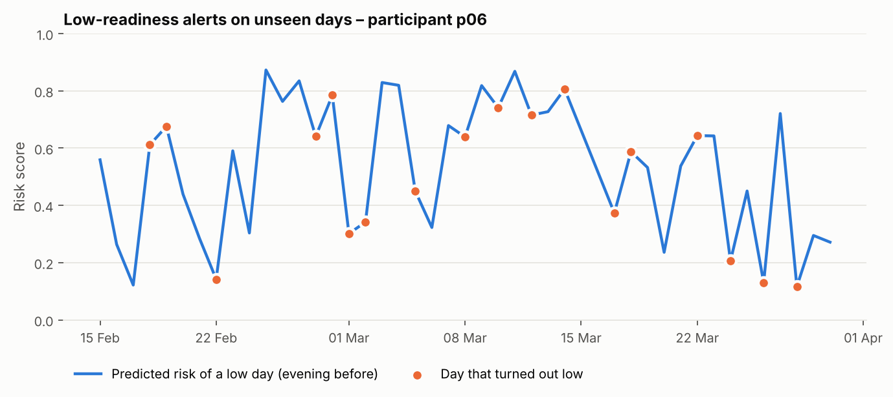
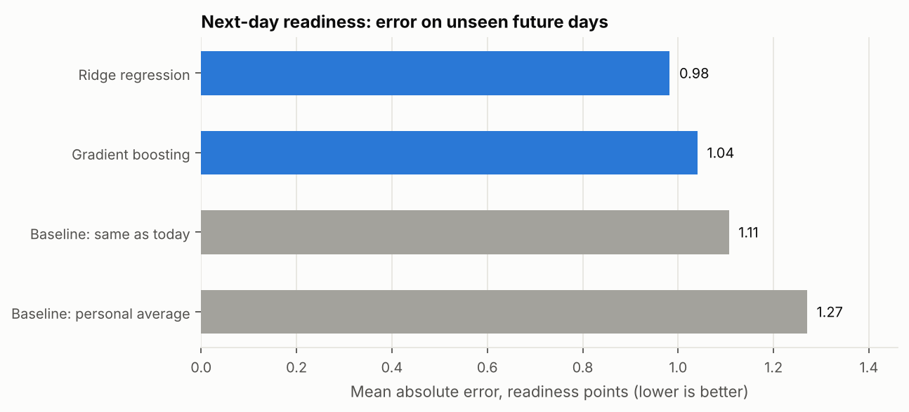
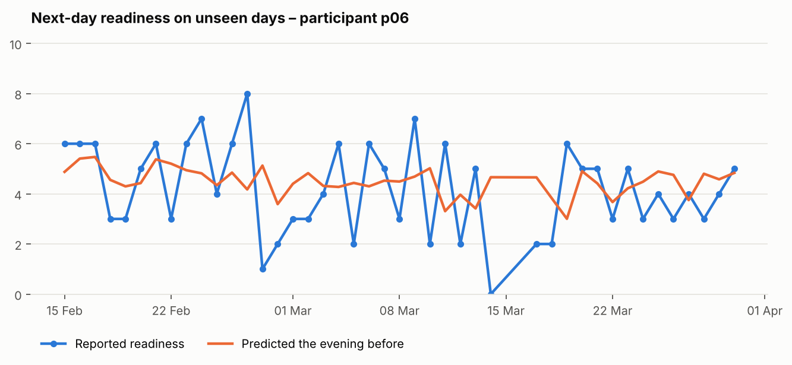
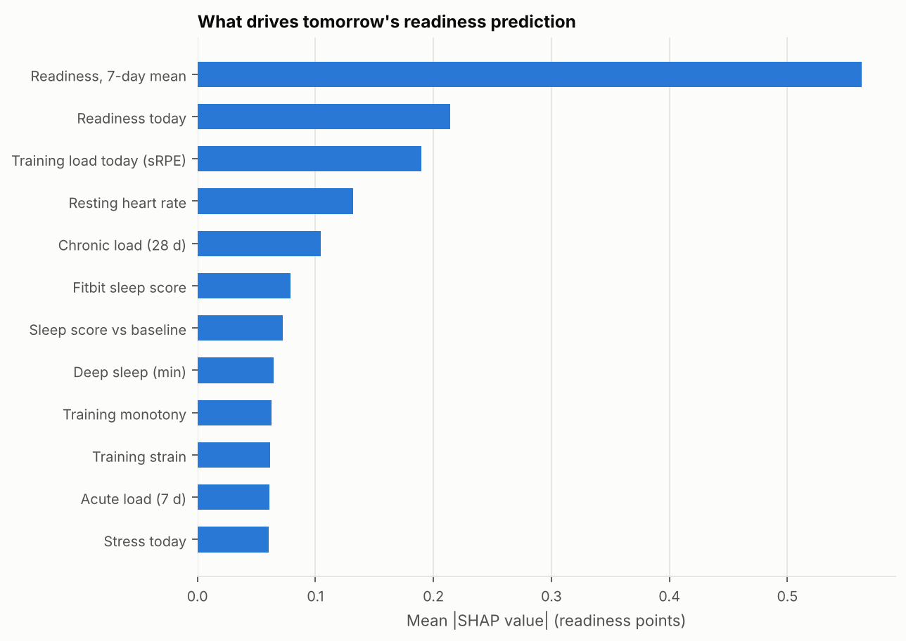

# Athlete Readiness Prediction

Predicting an athlete's **next-day readiness** from training load, sleep and resting heart rate, using the open [PMData](https://datasets.simula.no/pmdata/) sports logging dataset (16 participants, 5 months, Fitbit + daily wellness and session-RPE reports).

The question a performance team asks every evening: *given today's training, last night's sleep and how the athlete feels, how ready will they be tomorrow, and why?*



## What this project does

1. **Builds a daily athlete-monitoring table** from four data sources: wellness questionnaire, session-RPE training logs, Fitbit sleep score and Fitbit resting heart rate.
2. **Engineers sports-science features** per athlete, using only information available by the evening before:
   - Training load: session-RPE load (Foster), 7-day acute and 28-day chronic load, **acute:chronic workload ratio** (rolling and EWMA, Williams et al. 2017), training monotony and strain, rest days
   - Physiology: Fitbit sleep score, deep sleep, restlessness, resting heart rate, and **deviations from each athlete's own 28-day baseline**
   - Wellness: readiness, fatigue, soreness, stress, mood, sleep quality, and readiness trends relative to the athlete's baseline
3. **Predicts tomorrow's readiness (0–10)** with ridge regression and gradient boosting, and **flags likely low-readiness days** with a classifier, always compared with simple baselines a coach could use without any model.
4. **Evaluates two realistic scenarios**:
   - *Same athletes, future days*: train on the first 70% of each athlete's season, test on the last 30%
   - *New athletes*: leave-one-athlete-out, so the model never sees the test athlete
5. **Explains predictions with SHAP**, so coaches see *which* factors drive a low-readiness forecast.
6. **Exports a tidy table** (`reports/athlete_daily_features.csv`) ready for a Power BI dashboard.

## Results

All numbers are on data the models never saw. Full tables: [`reports/results.md`](reports/results.md).

**Data:** 16 participants, 2,211 athlete-days, 1,713 with a known next-day readiness. Three participants (p03, p09, p16) logged fewer than 5 training sessions in five months, so their load features are treated as missing rather than as rest days.

### Flagging low-readiness days

A *low day* is one clearly worse than usual for that athlete: at or below their own mean minus one standard deviation (15–18% of days). If performance staff review the 20% of athlete-days with the highest predicted risk:

| Method | Low days caught (recall) | Correct flags (precision) | ROC-AUC |
|---|---|---|---|
| Baseline: readiness was low today | 30% | 27% | 0.60 |
| Baseline: below personal norm today | 33% | 29% | 0.59 |
| Logistic regression | 28% | 24% | 0.56 |
| **Gradient boosting** | **43%** | **38%** | **0.68** |



### Predicting the readiness score



- On future days for the same athletes, ridge regression has the lowest average error (**0.98 points vs 1.11** for "tomorrow = today").
- The regression models play it safe: they track the athlete's typical level but smooth over sharp drops, which is why the dedicated classifier is the better tool for spotting bad days.
- For **completely new athletes** the gain is small (1.07 vs 1.15). Readiness is personal, so a few weeks of an athlete's own data matter more than the population model.



### What drives the predictions



Recent readiness dominates, followed by today's training load, resting heart rate, chronic load and sleep. This matches practice: an athlete's recent trend is the strongest signal, and load and recovery markers adjust it.

## Running it like a production model

The analysis above runs once. A real monitoring system runs every day for months, so the project is being extended step by step:

- [x] **Model versioning** – `train.py` trains the low-readiness classifier and saves it as a new version with a model card
- [ ] Prediction API
- [ ] Performance and data-drift monitoring
- [ ] Automated retraining pipeline

### Model versioning (`train.py`, `src/registry.py`)

```bash
python train.py --data data/raw            # train and register a new version
python train.py --data data/raw --promote  # ...and put it in production
```

Each run creates `models/registry/<version>/` with:
- `model.joblib`: the fitted model
- `metadata.json`: the **model card**: training data (athletes, dates, low-day rate), feature list, each athlete's personal low-day threshold, held-out evaluation scores next to the best simple baseline, a statistical profile of every feature (used later for drift monitoring), and the software versions and git commit

`models/production.json` points to the version in production and remembers the previous one, so rolling back is a single promotion. Training happens in two stages: the model is first scored on unseen future days (those scores go into the model card), then refit on all labelled data for production.

## Project structure

```
├── run_pipeline.py          # analysis: load → features → models → figures
├── train.py                 # train + version the production model
├── src/
│   ├── load_data.py         # reads PMData files into one daily table per athlete
│   ├── features.py          # load, ACWR, monotony, baselines, next-day target
│   ├── model.py             # models, baselines, temporal and leave-one-athlete-out evaluation
│   ├── plots.py             # README figures
│   └── registry.py          # versioned model storage + production pointer
├── tests/
│   ├── make_synthetic_pmdata.py   # fake data in PMData format, for testing only
│   └── test_pipeline.py
├── models/                  # model versions and the production pointer
└── reports/                 # figures, results.md, Power BI export
```

## How to run it

1. Download PMData from <https://datasets.simula.no/pmdata/> and unzip it into `data/raw/`, so you have `data/raw/p01/`, `data/raw/p02/`, and so on. Only these files are needed per participant: `pmsys/wellness.csv`, `pmsys/srpe.csv`, `fitbit/sleep_score.csv`, `fitbit/resting_heart_rate.json`.
2. Install and run:

```bash
pip install -r requirements.txt
python run_pipeline.py --data data/raw
```

To check the code without the real data: `python -m pytest -q` (uses synthetic data in the same format).

## Design choices

- **No look-ahead.** Every feature at day *t* uses only data available by that evening; baselines use past days only (`shift(1)`), and the evaluation splits by time.
- **Personal baselines.** Readiness, resting HR and sleep are compared with each athlete's own recent normal, because a resting HR of 55 means different things for different people.
- **Days without a logged session count as zero load**, which is what makes rolling load and ACWR meaningful. The exception is athletes who barely logged at all: for them a missing log is not a rest day, so their load features are set to missing and the models rely on wellness, sleep and heart rate instead.
- **Low-readiness days are defined per athlete** (their own mean minus one SD, from the training period only), since people use the 0–10 scale differently.
- **Alert metrics flag exactly 20% of days**, with ties broken randomly, so methods with whole-number scores are not favoured or penalised.

## Limitations

- 16 recreational participants, not elite athletes; readiness is self-reported.
- Fitbit estimates are consumer-grade and contain gaps.
- ACWR is useful for monitoring but debated as an injury predictor; here it is one input among many, not a decision rule.

## Next steps

- A **conversational layer** where practitioners ask questions in plain language ("Who had the biggest load spike this week?"), using an LLM with retrieval over the daily table.
- Use minute-level heart-rate data for training impulse (TRIMP) and HRV-style recovery markers.
- A Power BI squad dashboard built on `athlete_daily_features.csv`.

## Data and citation

Data: PMData, licensed CC BY 4.0. The raw data is not included in this repository.

> Thambawita, V., et al. (2020). PMData: a sports logging dataset. *Proceedings of the 11th ACM Multimedia Systems Conference (MMSys '20)*.

---

*Author: Konstantina Voukelatou, physiotherapist and MSc in Artificial Intelligence (Stockholm University).*
